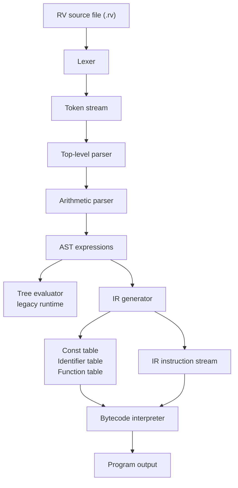

# RV Interpreter

RV is a small Python-like programming language implemented in C++. This repository contains the full RV execution pipeline: lexical analysis, parsing, AST construction, legacy tree-based evaluation, bytecode-style IR generation, and a virtual machine that executes the generated IR. It also includes a supported Flask backend for interpreter requests and is compatible with a live frontend visualizer deployment.

Live frontend:

```text
https://rv-interpreter-frontend.vercel.app/
```

The current default runtime is the IR generator plus bytecode interpreter. The older tree evaluator is still supported through a command-line flag and remains useful as a simpler semantic reference while the VM evolves.

## Architecture



At a high level:

- The lexer converts RV source text into typed tokens.
- The parser builds top-level AST nodes for statements such as variable assignments, loops, branches, and functions.
- The arithmetic parser handles expression parsing, including precedence, function calls, list literals, and indexing.
- The tree evaluator executes the AST directly.
- The IR generator lowers AST nodes into a compact instruction stream and supporting tables.
- The bytecode interpreter executes that IR with stack frames, register files, variable environments, and function return state.
- The Flask backend exposes the interpreter to the external visualizer.

## Language Snapshot

RV currently supports:

- Integer, boolean, string, and list values
- Variable declaration with `let`
- Reassignment and compound assignment
- Arithmetic, comparison, equality, boolean, and unary operators
- `if` / `else` control flow
- `while` loops
- Functions and `return`
- Recursive function calls
- List and string indexing
- List and string element mutation
- Builtins including `append`, `remove`, `type`, `string`, and `size`

Example:

```rv
function fact(n) {
    if (n == 1) {
        return 1;
    }

    return n * fact(n - 1);
}

let values = [1, 2, 3];
values[1] = fact(4);

print(values);
```

## Repository Layout

```text
src/
  lexer.cpp              Tokenizes RV source
  parser.cpp             Parses top-level language constructs
  arithmetic_parser.cpp  Parses expressions and operator precedence
  tree_evaluator.cpp     Legacy AST evaluator
  ir_generator.cpp       Lowers AST nodes into RV IR
  interpreter.cpp        Executes generated IR
  value.cpp              Runtime value model and operators
  builtins.cpp           Builtin RV functions
  main.cpp               CLI entry point

includes/                C++ headers
test_code/               RV programs used by tests
test_outputs/            Expected lexer/parser/runtime outputs
docs/legacy/             Preserved older documentation
app.py                   Flask API backend
tester.py                Python test harness
Makefile                 Primary local build commands
CMakeLists.txt           Alternate CMake build definition
```

## Build

The project uses C++20.

Build the main CLI executable:

```bash
make main
```

This produces:

```text
bin/main
```

Build the test executable:

```bash
make test
```

This produces:

```text
bin/test
```

The default `make` target also builds `bin/test`.

## Run RV Programs

Run a program with the default bytecode runtime:

```bash
./bin/main test_code/simple_add.rv
```

Run with the legacy tree evaluator:

```bash
./bin/main test_code/simple_add.rv --tree-evaluate
```

Print lexer output:

```bash
./bin/main test_code/simple_add.rv --output-lexer
```

Print parser output:

```bash
./bin/main test_code/simple_add.rv --output-parser
```

Print generated IR:

```bash
./bin/main test_code/simple_add.rv --output-ir
```

Flags can be combined:

```bash
./bin/main test_code/complex_function.rv --output-lexer --output-parser --output-ir
```

## CLI Flags

| Flag | Description |
| --- | --- |
| `--output-lexer` | Prints tokens grouped by source line. |
| `--output-parser` | Prints the parsed AST expression sequence. |
| `--output-ir` | Prints the generated IR instruction stream. |
| `--tree-evaluate` | Executes the AST directly with the legacy tree evaluator instead of the bytecode interpreter. |

Without `--tree-evaluate`, execution uses the IR generator and bytecode interpreter.

## Test

Run the full test harness:

```bash
python3 tester.py
```

The test runner compiles `bin/test` and executes the RV programs in `test_code/`, comparing output against files in `test_outputs/`.

## Run The Backend

The Flask backend expects the C++ executable to already exist.

Build the CLI first:

```bash
make main
```

Install Python dependencies:

```bash
pip3 install -r requirements.txt
```

Run the server:

```bash
flask run
```

The main API endpoint is:

```text
POST /interpret
```

The backend writes incoming source lines to `backend_code/user_script.rv`, runs `bin/main` with debug output flags, and returns lexer, parser, IR, and program-output data to the caller.

## Documentation

Detailed docs:

- [RV language reference](docs/language.md)
- [RV grammar](docs/grammar.md)
- [IR instruction reference](docs/ir.md)
- [Lexer internals](docs/lexer.md)
- [Parser internals](docs/parser.md)
- [Arithmetic parser internals](docs/arithmetic-parser.md)
- [Tree evaluator internals](docs/tree-evaluator.md)
- [IR generator internals](docs/ir-generator.md)
- [Bytecode interpreter internals](docs/bytecode-interpreter.md)

Current preserved legacy docs:

- [Legacy README](docs/legacy/README.md)
- [Legacy grammar notes](docs/legacy/grammar.md)
- [Legacy lexer notes](docs/legacy/lexer.md)
- [Legacy parser notes](docs/legacy/parser.md)

## Related Project

The interpreter can be used with a separate frontend visualizer:

```text
https://github.com/rohanvan123/rv-interpreter-frontend
```
